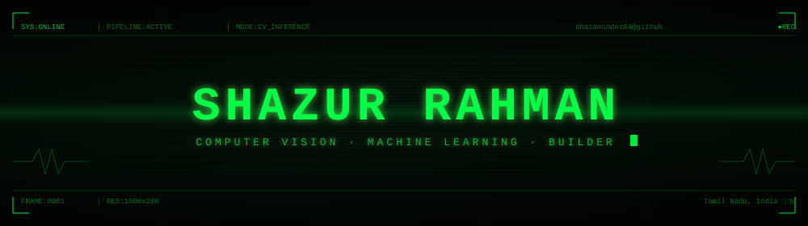

<div align="center">



<br/>

[](https://git.io/typing-svg)

<br/>

[](https://www.linkedin.com/in/shazur-rahman/)
[](mailto:shazurrahman2007@gmail.com)
[](https://github.com/shazamcodes64)
[](https://github.com/shazamcodes64)

</div>



```
╔══════════════════════════════════════════╗
║  PIPELINE  ›  INIT → PROCESS → TRANSMIT  ║
╚══════════════════════════════════════════╝
```

### `[ INIT ]` — whoami

```python
class ShazurRahman:
    def __init__(self):
        self.role       = "CSE (Computational Intelligence) undergrad · ML/CV Builder"
        self.location   = "Tamil Nadu, India 🇮🇳"
        self.stack      = ["Python", "Flutter", "FastAPI", "OpenCV", "PyTorch"]
        self.building   = "#OpenToWork — looking for opportunities"
        self.exploring  = ["Explainable AI", "Autonomous systems", "Applied ML research"]
        self.philosophy = "Ship the demo. Iterate from there."

    def collaborate_on(self):
        return ["computer vision", "applied ML", "autonomous systems"]
```


### `[ LOAD ]` — Toolbox

**`ML / CV`**


**`WEB / APP`**


**`PLATFORM`**


### `[ PROCESS ]` — Currently Building

```
  >> ACTIVE_JOB: Open To Work
  >> STATUS    : SEEKING_OPPORTUNITIES
  >> ROLES     : ML Engineer · CV Engineer · Full-Stack
```

> 🧿 **[AURA — Autism Risk Assessment](https://github.com/shazamcodes64/AURA-APP)** — gaze-based autism screening using only the device camera. Android and desktop apps that score gaze patterns into a clinician-facing report.


### `[ OUTPUT ]` — Selected Work

```
  >> SCANNING REPO... 5 objects detected.
```

| `#` | Project | Stack | Description |
|---|---|---|---|
| `01` | 🧿 **[AURA — Autism Risk Assessment](https://github.com/shazamcodes64/AURA-APP)** | Flutter · React · TypeScript · MediaPipe · Supabase | Gaze-based autism screening using only the device camera — Android and desktop apps that score gaze patterns into a clinician-facing report. |
| `02` | 📋 **[Kanban Task Management](https://github.com/shazamcodes64/gdg-srm-kanban)** | React · TypeScript | Drag-and-drop kanban board with To Do / In Progress / Done stages, toast notifications and auto-save. |
| `03` | 🤖 **[Campus AI Assistant](https://github.com/shazamcodes64/Campus-AI-Assistant)** | Python · Ollama · FAISS · RAG | On-prem, privacy-first campus assistant using a hybrid FAQ matcher + RAG pipeline with source citations. |
| `04` | 🎮 **[Nova Drift — Web Game Portal](https://github.com/shazamcodes64/nova-drift)** | Three.js · JavaScript | 3D endless dodge game with a game-hub portal interface. |
| `05` | 💬 **[Reddit Clone](https://github.com/shazamcodes64/Reddit-clone)** | Next.js · TypeScript · Prisma | Full-stack Reddit-style platform with AI moderation, nested comments, communities and a moderator dashboard. |


### `[ METRICS ]` — GitHub in Numbers

<div align="center">


&nbsp;


</div>


### `[ RENDER ]` — Computer Vision HUD




### `[ LOG ]` — Quote I'm Coding By

<div align="center">

```
  ┌─────────────────────────────────────────────────────────────────────┐
  │                                                                     │
  │   "Compatibility means deliberately repeating other people's        │
  │    mistakes."                                                       │
  │                                                                     │
  │                                      — David Wheeler (computer      │
  │                                        scientist)                   │
  │                                                                     │
  └─────────────────────────────────────────────────────────────────────┘
```

</div>


### `[ TRANSMIT ]` — Let's build something

<div align="center">

[](https://www.linkedin.com/in/shazur-rahman/)
[](mailto:shazurrahman2007@gmail.com)
[](https://github.com/shazamcodes64)

<br/>

```
  ⭐  If a project caught your eye, a star goes a long way.
  ──────────────────────────────────────────────────────
  >> END_OF_TRANSMISSION
```

</div>
